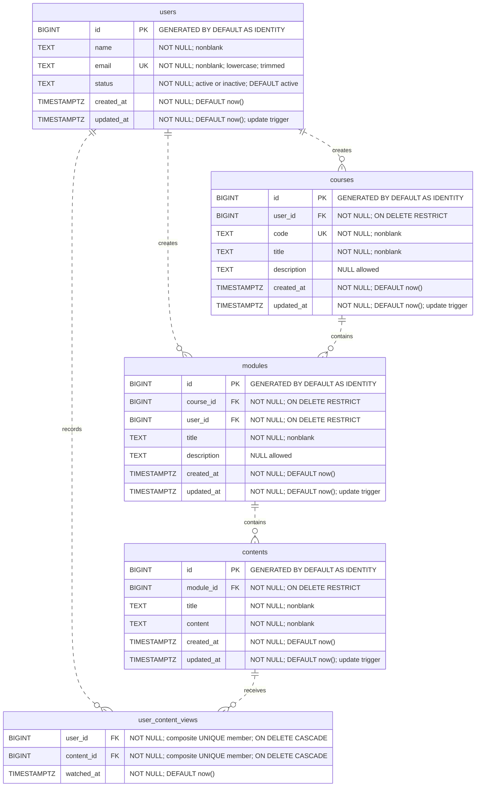

# Course Management System — DER

Este diagrama representa o esquema físico definido em [20261030000000_create_course_management_schema.sql](../supabase/migrations/20261030000000_create_course_management_schema.sql). Os nomes de tabelas, campos e relacionamentos permanecem em inglês.

A análise usa a migration, o [seed](../supabase/seed.sql), o [AGENTS.md](../AGENTS.md), o [README](../README.md) e os requisitos informados na conversa. Não foi localizado o enunciado original completo no repositório, nem foi consultado o banco remoto. O diagrama descreve o esquema versionado, sem propor alterações.

## Diagrama do esquema atual

`PK` identifica uma chave primária, `FK` uma chave estrangeira e `UK` uma restrição de unicidade individual. `nonblank` corresponde ao `CHECK (btrim(field) <> '')`. Não há limites específicos de tamanho para os campos `TEXT`.

**A tabela `user_content_views` não declara uma chave primária.** Ela possui a restrição composta `UNIQUE (user_id, content_id)`, com ambos os campos obrigatórios. Nenhum deles é único isoladamente; por isso, não estão marcados como `UK` individual no diagrama. Não há campo `id`, `created_at` ou `updated_at` nessa tabela.

## Relacionamentos e integridade

| Chave estrangeira | Referência | Exclusão do registro referenciado |
| --- | --- | --- |
| `courses.user_id` | `users.id` | `RESTRICT` |
| `modules.course_id` | `courses.id` | `RESTRICT` |
| `modules.user_id` | `users.id` | `RESTRICT` |
| `contents.module_id` | `modules.id` | `RESTRICT` |
| `user_content_views.user_id` | `users.id` | `CASCADE` |
| `user_content_views.content_id` | `contents.id` | `CASCADE` |

Cada curso tem exatamente um criador; cada módulo tem exatamente um curso e um criador; cada conteúdo tem exatamente um módulo. O criador de um módulo pode ser diferente do criador do curso.

Cada registro de visualização referencia exatamente um usuário e um conteúdo. A associação permite que um usuário visualize vários conteúdos e que um conteúdo seja visualizado por vários usuários. A unicidade do par impede duplicidade, sem impor qualquer unicidade a `watched_at`.

Do lado dos registros dependentes, a migration permite zero ou muitos: um usuário pode não ter cursos, módulos ou visualizações; um curso pode não ter módulos; um módulo pode não ter conteúdos; um conteúdo pode não ter visualizações. O DER usa `o{` para refletir essa possibilidade real do esquema. As relações são não identificadoras (`..`): as chaves estrangeiras não compõem uma chave primária declarada nas tabelas dependentes.

Excluir um conteúdo remove suas visualizações automaticamente. Excluir um usuário remove suas visualizações somente se nenhuma referência de curso ou módulo bloquear a exclusão. Excluir um módulo com conteúdos ou um curso com módulos é bloqueado.

Também estão definidos:

- `users.email` único, não vazio, em letras minúsculas e sem espaços nas extremidades.
- `courses.code` único; títulos não possuem restrição de unicidade.
- `users.status` limitado a `active` e `inactive`, com padrão `active`.
- Descrições opcionais em cursos e módulos; os demais campos são obrigatórios.
- Triggers nas quatro entidades principais para atualizar `updated_at` com `clock_timestamp()`.
- Índices nas chaves estrangeiras; o índice da restrição composta de visualizações já começa por `user_id`, e há índice separado por `content_id`.
- RLS habilitada nas cinco tabelas, sem políticas públicas, com acesso de servidor concedido ao `service_role`.

## Conferência do seed com os requisitos informados

Os requisitos fornecidos são: cinco usuários, três cursos, módulos distribuídos em `5/3/2`, conteúdos distribuídos em `3/5/4` e pelo menos um conteúdo por módulo.

| Item | Requisito informado | Seed atual | Resultado |
| --- | --- | --- | --- |
| Usuários | 5 | 5 | Atendido no seed |
| Cursos | 3 | 3 | Atendido no seed |
| Módulos do curso 1 | 5 | 5 | Atendido no seed |
| Módulos do curso 2 | 3 | 3 | Atendido no seed |
| Módulos do curso 3 | 2 | 2 | Atendido no seed |
| Conteúdos do curso 1 | 3 | 5 | Divergência: dois conteúdos a mais |
| Conteúdos do curso 2 | 5 | 5 | Atendido no seed |
| Conteúdos do curso 3 | 4 | 4 | Atendido no seed |
| Total de conteúdos | 12 | 14 | Divergência decorrente do curso 1 |
| Pelo menos um conteúdo por módulo | Todos os 10 módulos | Todos possuem conteúdo | Atendido no seed; não garantido pela migration |

A distribuição de conteúdos por módulo é:

| Curso | IDs dos módulos | Conteúdos por módulo | Total |
| --- | --- | --- | --- |
| 1 | `1, 2, 3, 4, 5` | `1, 1, 1, 1, 1` | 5 |
| 2 | `6, 7, 8` | `2, 2, 1` | 5 |
| 3 | `9, 10` | `2, 2` | 4 |

O seed também contém sete visualizações, sem pares usuário/conteúdo repetidos. Os registros referenciados pelas chaves estrangeiras estão presentes no próprio seed. O README descreve corretamente as quantidades atuais, incluindo os cinco conteúdos do curso 1; isso não elimina a divergência com a quantidade informada para a atividade.

## Divergências e decisão necessária

1. **Os requisitos informados para o curso 1 são incompatíveis entre si.** Cinco módulos com pelo menos um conteúdo em cada exigem, no mínimo, cinco conteúdos. Como cada conteúdo pertence a um único módulo, três conteúdos não podem preencher os cinco módulos. Não é possível cumprir simultaneamente as duas condições com o modelo informado.
2. **O seed prioriza a cobertura dos módulos.** Ele contém cinco conteúdos no curso 1, satisfazendo o mínimo por módulo, mas excedendo os três conteúdos solicitados. Não se deve reduzir automaticamente o seed, pois isso deixaria pelo menos dois módulos sem conteúdo.
3. **A migration não garante o mínimo de um conteúdo por módulo.** A chave estrangeira exige que cada conteúdo tenha um módulo existente, mas não exige que cada módulo tenha conteúdo. O seed atende à regra no estado inicial; a estrutura permite módulos vazios. A eventual exigência de uma garantia permanente precisa ser esclarecida com o professor.
4. **Não há chave primária formal em `user_content_views`.** A combinação obrigatória e única impede duplicidades, mas não é uma declaração `PRIMARY KEY`. O AGENTS.md orienta usar chaves primárias; é necessário conferir se a atividade exige uma em todas as tabelas, inclusive na associativa, antes de propor qualquer migration.

É necessário confirmar com o professor qual condição prevalece: os três conteúdos exatos do curso 1 ou o mínimo de um por módulo. Caso as quantidades sejam mínimas, em vez de exatas, os cinco conteúdos podem atender; essa interpretação não foi presumida.

As quantidades do seed não são limites fixos do esquema, que permite cadastrar outros registros. Nenhuma migration, seed, tabela ou dado existente foi alterado para produzir este documento. A conformidade com o enunciado completo e o estado do banco remoto continuam sem comprovação nesta análise.
